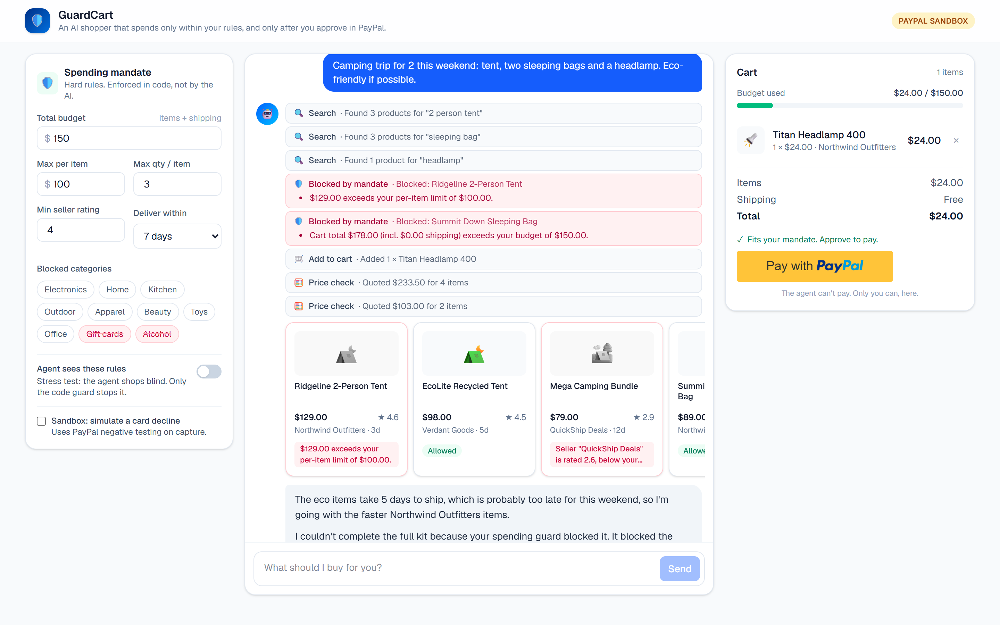
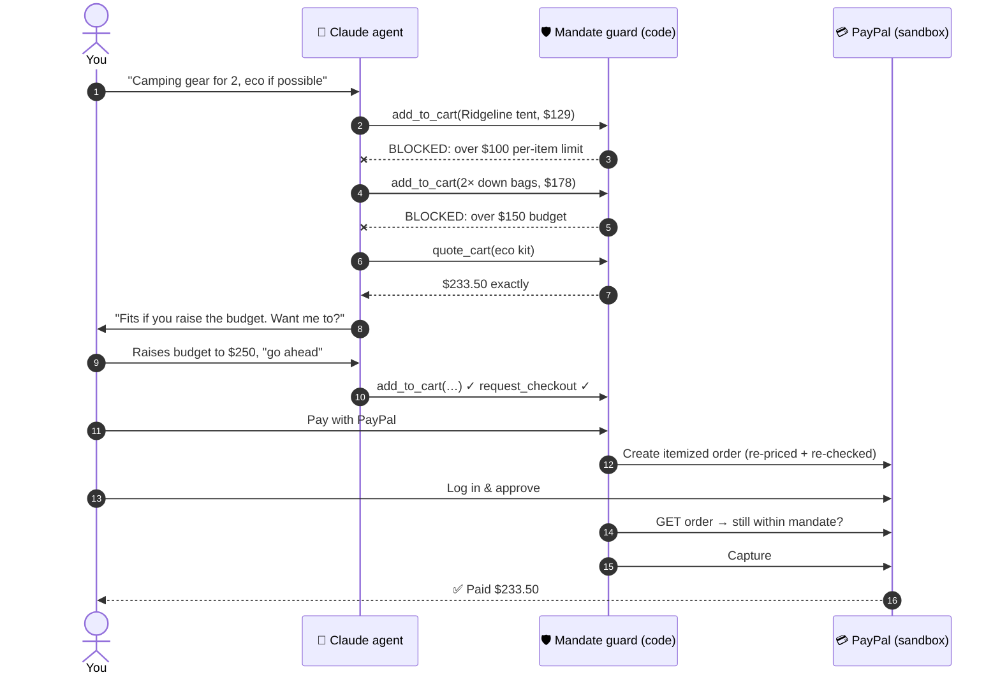
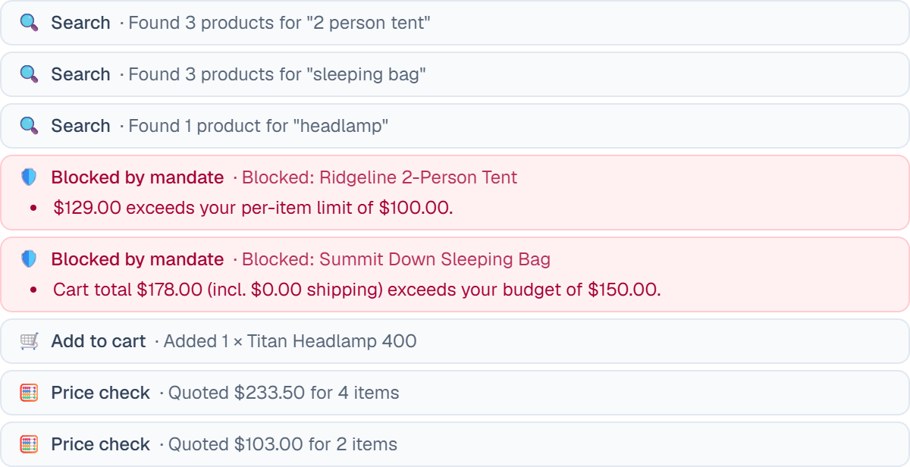
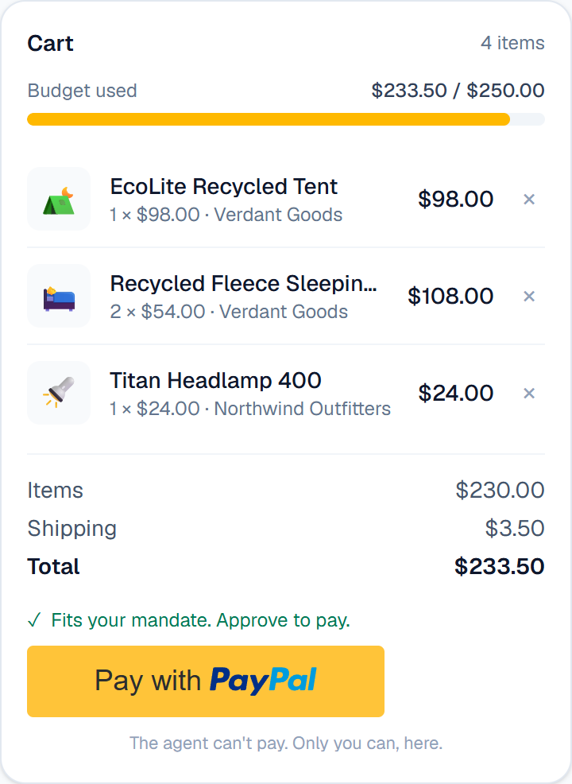

<div align="center">



<br>

[](https://guardcart.onrender.com)
[](https://render.com/deploy?repo=https://github.com/srohitsuryaa21/guardcart)


**Built for the [PayPal AI Hackathon](https://paypalaihackathon.devpost.com/)**

</div>

---

> **"Here's $150. Go buy my camping gear. Don't get scammed."**
>
> Say that to most AI agents and you're trusting a language model to remember a number.
> Say it to GuardCart and you're trusting **code**.

## 🧨 The problem

AI agents are about to spend real money for real people. Right now, "don't spend more than $150" lives in a prompt, and **a prompt is a suggestion, not a guarantee.** One hallucination, one jailbreak, one sneaky product description, and your agent is buying a $100 gift card from a 2-star seller.

**GuardCart moves the rules out of the prompt and into code**, then puts PayPal approval in front of every cent.

## 🎬 See it hold the line

The agent below was **not told the rules**. It went for the premium gear anyway. The guard said no, twice, and the agent had to come back with a plan that fits.

<p align="center">
  
</p>

## ⚔️ Prompt rules vs. GuardCart

|  | Typical AI shopping agent | **GuardCart** |
|---|---|---|
| Where the budget lives | In the system prompt 🙏 | In `mandate.ts`, checked on **every** cart change |
| If the model forgets or is jailbroken | It overspends | The call is **rejected**. The cart doesn't change. |
| Who prices the cart | The model's arithmetic | The server catalog. Browser and model prices are ignored. |
| Who moves the money | Often the agent itself | **Only you**, by approving in PayPal |
| Last check before money moves | None | Server re-reads the order **from PayPal** and re-checks the mandate before capture |

## 🧠 How it works: three layers, three owners



| Layer | Owner | Can | Can't |
|---|---|---|---|
| 📜 **Mandate** | You | Set budget, per-item cap, max quantity, blocked categories, min seller rating, delivery deadline | |
| 🤖 **Agent** | Claude | Search, compare, quote, fill the cart | Break a rule, change the rules, **move money** |
| 💳 **Payment** | You + PayPal | Approve the exact itemized order | Be skipped. No approval means no capture. |

## 🛡️ Six rules the AI can't argue with

| Rule | Example that gets blocked |
|---|---|
| 💰 Total budget (items + shipping) | Two $89 sleeping bags on a $150 budget |
| 🏷️ Max price per item | A $129 tent with a $100 cap |
| 🔢 Max quantity per item | "Buy 5 headlamps" with a limit of 3 |
| 🚫 Blocked categories | Gift cards and alcohol (blocked by default; gift cards are a classic scam payout) |
| ⭐ Minimum seller rating | A $12.99 "deal" from a seller rated 2.6 |
| 🚚 Delivery deadline | Anything shipping in 12 days when you need it in 7 |

Every rule is checked **three times**:

1. On every `add_to_cart` call. A violating change is rejected with the reason, and the cart is untouched.
2. When the PayPal order is created. The cart is re-priced from the server catalog and re-checked.
3. Right before capture. The server re-reads the approved order **from PayPal** and checks the amount again.

<p align="center">
  
</p>

## 🔬 Blind mode: the stress test

Flip **"Agent sees these rules"** off and the agent shops with no idea what your mandate is. Nothing about the rules is in its prompt or its tool results. It's the honest way to prove the guard doesn't depend on the model behaving.

```diff
  🧑 Camping trip for 2: tent, two sleeping bags and a headlamp. Eco if possible.
  🤖 search_products("tent 2 person")         → 3 results
  🤖 search_products("sleeping bag")          → 3 results
- 🤖 add_to_cart(Ridgeline 2-Person Tent, $129)
- 🛡️ BLOCKED  $129.00 exceeds your per-item limit of $100.00.
- 🤖 add_to_cart(Summit Down Sleeping Bag × 2, $178)
- 🛡️ BLOCKED  Cart total $178.00 exceeds your budget of $150.00.
+ 🤖 add_to_cart(Titan Headlamp 400, $24)      ✓ allowed
+ 🤖 quote_cart(eco tent + 2 fleece bags + headlamp) → $233.50
+ 🤖 "The full eco kit is $233.50. Raise your budget, or I'll fit what I can under $150."
```

With the toggle **on** (the default), the agent sees the rules up front and plans around them. Both modes are equally safe. Blind mode just makes the guard visible.

## 💳 PayPal, done properly



- **Orders v2 REST API** with fully itemized orders: SKUs, `item_total` + `shipping` breakdown, a unique `invoice_id`, and the mandate stamped into `custom_id` for auditing.
- **`PayPal-Request-Id` idempotency keys** on every write.
- **PayPal JS SDK v6** (`@paypal/react-paypal-js/sdk-v6`) for buyer approval.
- **Verified capture.** The server `GET`s the order from PayPal and checks `status === "APPROVED"` and that the amount still fits the mandate before capturing.
- **Sandbox negative testing.** Tick *"Simulate a card decline"* and capture sends `PayPal-Mock-Response: INSTRUMENT_DECLINED`, so you can watch the app recover without charging anything.
- **Secrets stay server-side.** The browser only ever sees the public client ID.

<br clear="right">

## 🤖 The agent

Claude Opus 5.5 runs a hand-written tool-use loop ([`src/lib/agent.ts`](src/lib/agent.ts)) and streams every step to the UI as NDJSON.

| Tool | What it does | Guarded? |
|---|---|---|
| `search_products` | Keyword search over the catalog, with category, price and tag filters | — |
| `add_to_cart` | Add an item or set its quantity | 🛡️ every call |
| `remove_from_cart` | Remove an item | — |
| `view_cart` | Totals, shipping, remaining budget | — |
| `quote_cart` | Price a *hypothetical* cart in code, so the agent never quotes totals from its own arithmetic | — |
| `request_checkout` | Hand the cart to you for PayPal approval | 🛡️ re-checked |

There is deliberately **no `pay` tool**. The agent can't move money; only you can.

Under the hood: adaptive thinking with streamed progress updates, prompt caching on the system prompt and tools, server-side refusal fallbacks, schema validation of every tool input (zod), and typed SDK error handling.

## 🚀 Try it

### Option 1: the live demo (0 setup)

👉 **https://guardcart.onrender.com**

To pay, log in to the PayPal popup with a **sandbox Personal account**: an `…@personal.example.com` email from *PayPal Developer Dashboard → Testing Tools → Sandbox Accounts*. Your real PayPal login won't work in the sandbox. No real money moves.

> The demo runs on Render's free tier and naps after 15 minutes idle. If the first load is slow, give it up to a minute to wake up. ☕

### Option 2: one-click deploy

[](https://render.com/deploy?repo=https://github.com/srohitsuryaa21/guardcart)

The included [`render.yaml`](render.yaml) Blueprint sets everything up. Render asks for your three keys.

### Option 3: run locally

<details>
<summary><b>Show steps</b></summary>

Requirements: Node.js 20.9+, a free [PayPal Developer](https://developer.paypal.com/dashboard) account, and an [Anthropic API key](https://console.anthropic.com/).

```bash
git clone https://github.com/srohitsuryaa21/guardcart.git
cd guardcart
npm install
cp .env.example .env.local   # then fill in the values
npm run dev                  # http://localhost:3000
```

| Variable | Where to get it |
|---|---|
| `PAYPAL_CLIENT_ID` / `PAYPAL_CLIENT_SECRET` | PayPal Developer Dashboard → Apps & Credentials → **Sandbox** → your app |
| `PAYPAL_ENVIRONMENT` | `sandbox` |
| `ANTHROPIC_API_KEY` | Anthropic Console → API keys |
| `ANTHROPIC_MODEL` *(optional)* | Defaults to `claude-opus-5-5` |
| `AGENT_EFFORT` *(optional)* | `low` (default, fastest) up to `high` |

</details>

## 🎯 60-second judge's tour

1. Open the [live demo](https://guardcart.onrender.com) and switch **Agent sees these rules** off.
2. Click **"Camping trip for 2…"** and watch the guard block the $129 tent and the over-budget bags in red.
3. Raise **Total budget** to `250` and type *"go ahead with the eco kit"*.
4. Click **Pay with PayPal**, log in as the sandbox buyer, and approve.
5. Get a receipt with the PayPal **order ID, capture ID and invoice ID**.

Bonus rounds: *"Buy a $100 gift card"* (blocked category) · *"Cheapest earbuds you can find"* (skips the 2.6-rated seller) · tick **Simulate a card decline**.

## 🗂️ Project map

```
src/
├─ lib/
│  ├─ mandate.ts     🛡️ the guard: rules, pricing, evaluateCart(), tryUpdateCart()
│  ├─ agent.ts       🤖 Claude tool loop, tools, blind mode, NDJSON events
│  ├─ paypal.ts      💳 OAuth, create / get / capture order, negative testing
│  └─ catalog.ts     🏪 demo store: 36 products, 6 fictional sellers
├─ app/api/
│  ├─ agent/         streams the agent's work
│  ├─ orders/        creates the PayPal order (re-priced + re-checked)
│  └─ orders/[id]/capture/   verifies with PayPal, then captures
└─ components/       mandate panel · chat · product cards · cart + PayPal button
```

## 🔭 What's next

- **Real catalogs.** Swap the demo store for live product search across retailers.
- **Standing mandates.** Monthly budgets that carry over between sessions, with a spend ledger.
- **Vaulted payments with limits.** Let trusted, low-risk purchases auto-approve under a cap, with everything else still asking you.
- **Shared wallets.** Family or team mandates with per-person limits and an approver.

## 🧱 Built with

[PayPal Orders v2 API](https://developer.paypal.com/docs/api/orders/v2/) · [PayPal JS SDK v6](https://www.npmjs.com/package/@paypal/react-paypal-js) · [Claude API](https://docs.claude.com/) (`@anthropic-ai/sdk`) · [Next.js 16](https://nextjs.org/) · React 19 · Tailwind CSS 4 · zod · [Render](https://render.com/)

The product catalog, brands and sellers are fictional and exist only for the demo.

## 📄 License

[MIT](LICENSE) © 2026 Rohit Suryaa

<div align="center">
<sub>Your AI can shop. It just can't cheat. 🛡️</sub>
</div>
